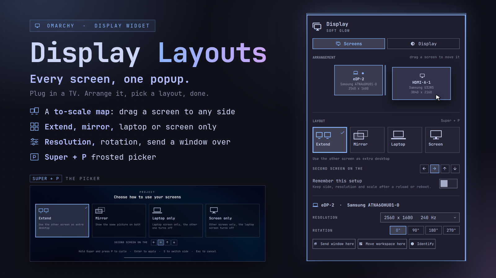
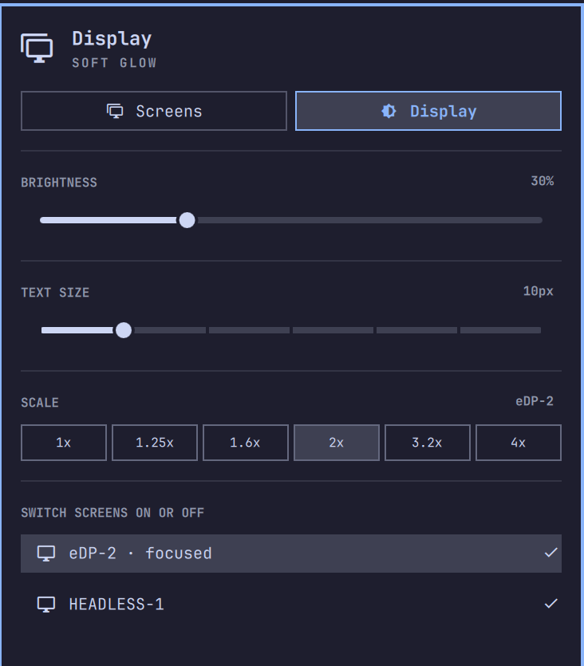
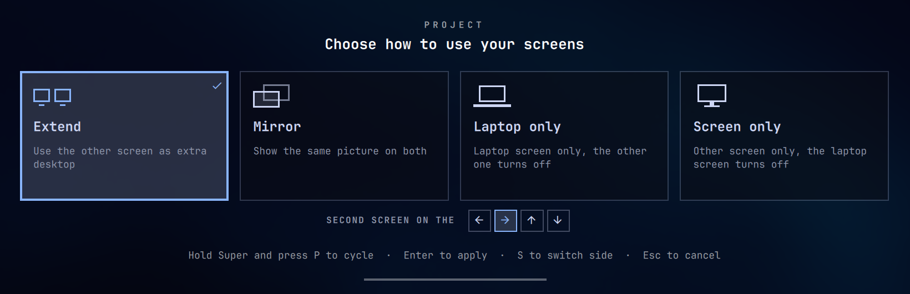

# Display Layouts



A better display popup for Omarchy. It started as a Windows `Win+P` style layout
picker for my laptop and TV setup and grew into one place for everything about
your screens.

It replaces the stock Display widget and keeps all of it: brightness, text size,
scale, and switching screens on or off now live on a **Display** tab. The new
**Screens** tab adds:

- **Arrangement map.** Your screens drawn to scale. Click one to select it, drag
  an external screen to another side of the laptop and it snaps there.
- **Layouts.** Extend, Mirror, Laptop only or Screen only, plus which side the
  second screen goes on (left, right, above, below).
- **Per-screen settings.** Resolution and refresh rate, rotation, and buttons to
  send the active window or the current workspace to that screen.
- **Identify.** Flashes each screen's name and resolution on that screen.
- **Remember this setup.** Keeps placement, resolution and scale across a reload
  or reboot.

There is also a full-screen picker you can open with **Super + P**. It frosts
the screen behind it and closes by itself after 10 seconds if you choose nothing.

| | |
| --- | --- |
|  |  |

## Install

```
omarchy plugin add https://github.com/Abhijay09/omarchy-display-layouts --enable
```

This replaces the built-in Display widget (it keeps the same `omarchy.monitor`
IPC target, so the brightness keys keep working), so don't enable both. If
`--enable` doesn't swap it in on your bar:

```
omarchy bar move io.github.abhijay09.display-layouts --section right
```

If the popup still looks like the old one, run `omarchy restart shell`. The shell
doesn't always pick up a changed plugin on its own.

### Super + P

A plugin can't add keybindings, so add these lines to `~/.config/hypr/bindings.lua`:

```lua
hl.unbind("SUPER + P") -- was: Pseudo window
o.bind("SUPER + P", "Project display", "omarchy-shell omarchy.monitor project")
```

Omarchy binds `SUPER + P` to "Pseudo window" by default, so the first line frees it.
Without it both would run on every press. If you use pseudo-tiling, pick another key
for one of them.

Press it once to open the picker with your current layout selected. Press it again
to step to the next layout, or use the arrow keys, Tab, `1`-`4`, `S` to change the
side and Esc to cancel. Enter or a click applies the layout. If you do nothing for 10 seconds it closes on
its own (a thin bar under the hint shows the time left, and any key press or mouse
move starts it over). Letting go of Super
applies it too, as long as you stepped with the key and your compositor forwards the
key release to the picker. Enter always works.

## Requirements

- Omarchy with the Lua Hyprland config (`hyprctl eval` support)
- `hyprctl` and `jq` (both ship with Omarchy)
- Omarchy's own `omarchy-hyprland-monitor-*` and `omarchy-notification-send` commands

Nothing else to install.

## Remove

If you turned on "Remember this setup", turn it off first so the file it wrote is
deleted:

```
~/.config/omarchy/plugins/io.github.abhijay09.display-layouts/displayctl remember off
omarchy plugin remove io.github.abhijay09.display-layouts
omarchy plugin enable omarchy.monitor right
```

The last line puts the stock Display widget back. Also remove the `SUPER + P` line
from `bindings.lua` if you added them, and the unbind line too if you want pseudo window back.

## How it works

`displayctl` is a small shell script that does the actual work. Run it without
arguments for the list of commands.

| Command | |
| --- | --- |
| `displayctl layout extend [left\|right\|up\|down]` | second screen as extra desktop |
| `displayctl layout mirror` / `internal` / `external` | mirror, laptop only, screen only |
| `displayctl side <output> <side>` | move a screen to a side of the laptop |
| `displayctl mode <output> <WxH@Hz>` | resolution and refresh rate |
| `displayctl scale <output> <factor>` / `rotate <output> <0-3>` | scale, rotation |
| `displayctl send <output>` / `workspace <output>` | move the active window / workspace |
| `displayctl remember on\|off\|status` | keep the setup after a reload |

It reads the current state from `hyprctl monitors all -j`, changes one thing and
carries the rest over, and applies it with `hyprctl eval hl.monitor(...)` and
Omarchy's own mirror and laptop-screen commands. External screens are always placed
with `auto-left/right/up/down`, so changing a screen's size or rotation never
leaves it overlapping the laptop screen. `DISPLAYCTL_DRY=1` prints the Lua instead
of running it.

"Remember this setup" writes `~/.local/state/omarchy/toggles/hypr/display-layouts.lua`,
which Omarchy already loads on every reload. It covers placement, resolution, scale
and rotation of external screens. Mirroring and switching the laptop screen off are
remembered by Omarchy itself, and a switched-off external screen is deliberately not
saved, so plugging in a TV later doesn't leave it dead.

Run the model tests with `node test/model.test.js`.

## Known issues

- Developed on one machine (Lenovo, Intel + NVIDIA hybrid). Other setups may need
  tweaks, and issues or PRs are welcome.
- **HDMI on hybrid-GPU laptops:** on many of these the HDMI port hangs off the
  NVIDIA GPU. If the GPU is in an integrated or VFIO mode (for example via
  `supergfxctl`), the TV gets no signal and Hyprland never sees the output. Switch
  to Hybrid mode and log back in. Hyprland only looks for GPUs at startup, so a
  re-login is needed.
- Dragging on the map only places a screen on a side of the laptop screen. There is
  no free positioning or alignment offset.
- With more than one external screen only the first one is handled by the layout
  cards. The map and the per-screen settings work for all of them.
- The Display tab keeps the stock widget's keyboard navigation. The Screens tab is
  mouse-driven, apart from the Super + P picker.

## Credits

Based on `omarchy.monitor` from [Omarchy](https://github.com/omacom/omarchy) (MIT).

## License

MIT, see [LICENSE](LICENSE).
